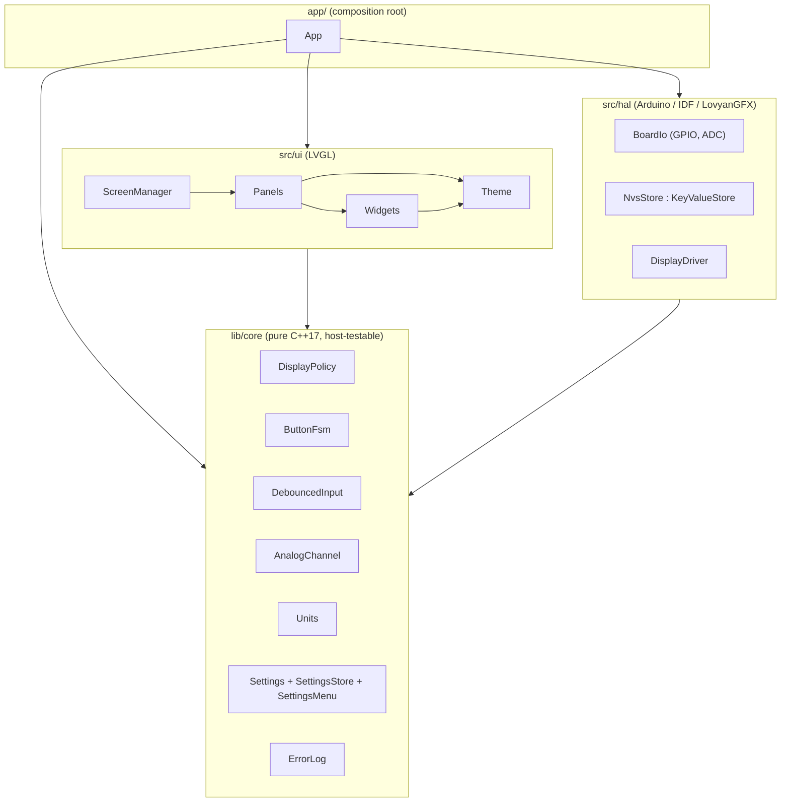

# Clarity: Production Restructure Plan

| | |
|---|---|
| **Status** | Proposal, not started |
| **Date** | 2026-11-03 |
| **Baseline** | `main` @ `b947e41` (plus the uncommitted `docs/todo.md`) |
| **Scope** | All firmware (`src/`, `include/`), build config, tests, CI and docs |
| **Method** | Static review of every source, header, build and test file, plus the existing docs. Nothing was compiled or run: PlatformIO was not installed on the review machine. Findings marked **Verify** depend on runtime behaviour and need confirming on hardware or in Wokwi before you act on them. |

This document replaces the "Project Review Findings" section of `docs/todo.md`. It includes every item from that list, corrects two of them (see [§7.1](#71-platformioini) and [C-06](#c-06-exceptions-and-error-returns)), and goes much further.

---

## Contents

0. [Reading guide](#0-reading-guide)
1. [Executive summary](#1-executive-summary)
2. [Functional baseline to retain](#2-functional-baseline-to-retain)
3. [Defects found](#3-defects-found)
4. [Architecture assessment](#4-architecture-assessment)
5. [Target architecture](#5-target-architecture)
6. [Code-level changes](#6-code-level-changes)
7. [Build, toolchain and configuration](#7-build-toolchain-and-configuration)
8. [Testing and CI](#8-testing-and-ci)
9. [Production hardening](#9-production-hardening)
10. [Documentation](#10-documentation)
11. [Migration plan](#11-migration-plan)
12. [Decisions required](#12-decisions-required)
13. [Appendix A: per-file disposition](#appendix-a-per-file-disposition)

---

## 0. Reading guide

**Item IDs.** `D-` defect, `A-` architecture, `C-` code, `B-` build, `T-` test, `H-` hardening, `X-` docs, `Q-` decision for the owner.

**Severity.**

| Level | Meaning |
|---|---|
| **S1 Critical** | Memory safety, lock-up, crash or data loss |
| **S2 High** | A user-visible feature is broken or silently wrong |
| **S3 Medium** | Fragile, costly to maintain, or a performance risk |
| **S4 Low** | Hygiene |

**Confidence.** *Confirmed* means the code path is unambiguous on reading. **Verify** means the outcome depends on runtime state (heap layout, timing, toolchain flags).

**"Retain functionality."** [§2](#2-functional-baseline-to-retain) defines the behaviour to keep, taken from the code (not the docs). Every fix that would change observable behaviour is flagged and has a matching decision in [§12](#12-decisions-required).

---

## 1. Executive summary

### Verdict

The firmware does its job: two animated gauges, priority-driven override screens, a single-button settings menu, persisted settings and an error viewer. But the code is roughly three times the size it needs to be. Much of that size makes the system *less* safe rather than more.

- **The patterns are mostly ceremony.** Two factories, 11 interfaces with one implementation each, 5 singletons that are *also* injected, a "Trigger/Action interrupt" framework that polls 5 GPIOs, a string-keyed config registry with run-time schema registration and change callbacks, and a `Reading` variant over 5 types. In several places these layers *hide* defects: configuration items that silently do nothing, and a change callback that can never fire.
- **There are real memory-safety and liveness bugs.** Leaving the oil panel double-deletes LVGL objects (D-01). Splash timers can outlive their panel (D-02). In release builds the UI can lock up permanently after the user views the last error (D-03). A failed init leaves `loop()` dereferencing null (D-04).
- **The safety net is gone.** The CI workflows were deleted (`dd8524c`). The automated Wokwi scenario waits for 9 log lines the firmware no longer prints (D-22). There are no unit tests.
- **About 37% of source lines are comments** (6,216 of 16,519, excluding icons and `lv_conf.h`). Many are stale or wrong: they describe interfaces, files and APIs that don't exist.

### Recommended shape

Replace MVP with a small, layered design driven by one event loop:

- A **pure-C++ core**: input debouncing, the button state machine, a display-priority policy, units, settings model and error log. It has no Arduino or LVGL dependencies and is unit-tested on the host.
- A thin **hardware layer**: GPIO/ADC reads, NVS, and the display driver.
- A **UI layer**: screens and widgets on LVGL, with one rule for object ownership.
- **One composition root** in `main.cpp`, with no globals, singletons or factories.

The trigger and restoration behaviour becomes a pure function of input state (see [A-02](#a-02-display-policy-as-a-pure-function)). That removes the `UIState` BUSY/IDLE gate and the class of bugs it causes.

### Indicative impact (estimates, not commitments)

| Metric | Today | Target |
|---|---|---|
| Source lines (excl. icons, `lv_conf.h`) | 16,519 | ~6,000–8,000 including tests |
| Interfaces | 11 | 1–2 (only at real seams, e.g. key-value store) |
| Singletons / `Instance()` call sites | 5 / 137 | 0 / 0 |
| Static self-registration blocks | 6 | 0 |
| Heap allocations per rendered frame | dozens (string config look-ups, see C-02) | ~0 in steady state |
| Host unit tests | 0 | ~60–100 cases across core modules |
| CI | none | build all envs + native tests + static analysis + Wokwi |
| Icon flash | ~270 KB | ~50–70 KB (see B-05) |

### Top priorities

1. Restore a working safety net: fix the Wokwi scenario, restore CI, pin versions (Phase 0).
2. Fix S1 defects D-01 to D-04 in place, before restructuring (Phase 1).
3. Replace the interrupt framework and `UIState` gate with the display policy and deferred transitions (A-02, A-05).
4. Replace the config registry with typed settings, keeping NVS compatibility (A-07). This also fixes the 5 non-functional settings in D-05.
5. Remove factories, singletons, globals and single-implementation interfaces (A-01, A-03).

---

## 2. Functional baseline to retain

This is the behavioural contract, derived from the code. Where the code and the docs disagree, the code wins here and the gap is listed in [§2.10](#210-documented-behaviour-that-differs-from-the-code).

### 2.1 Boot

1. Initialise the GC9A01 240×240 display over SPI2 at 80 MHz with DMA. Colour inversion is on for hardware builds (`INVERT`). Wokwi builds apply a mirror/BGR fix (`WOKWI_EMULATOR`). Backlight is at 100%. LVGL 9 runs with two partial render buffers.
2. Load all settings from NVS, falling back to defaults for missing keys.
3. Initialise LVGL styles and apply the user theme (`style_manager.theme`, default `Day`).
4. Evaluate the vehicle inputs once. If a panel override is active (key or lock), show it directly with no splash, and skip the default panel. If lights are on, apply the Night theme.
5. Otherwise show the default panel (`system.default_panel`, default Oil). If `system.show_splash` is true (the default), show the splash first.
6. Splash: the "Clarity" label fades in, holds 500 ms, fades out, then the target panel loads. Total duration comes from `splash_panel.duration` (1500/1750/2000/2500 ms). Each fade lasts `(duration − 500) / 2` ms.

### 2.2 Display priority and restoration

| Priority | Source | Effect |
|---|---|---|
| 1 (highest) | Any pending error | Error panel, with the Error theme |
| 2 | Key present (GPIO 25) **or** key not present (GPIO 26) | Key panel. Green icon if present, red if not present. If both are active, "present" wins. |
| 3 | Lock (GPIO 27) | Lock panel (red icon) |
| — | Lights (GPIO 33) | Style only: Night theme on, Day theme off. Does not change the panel. |
| base | User panel | The "restoration panel": the default panel at boot, then whichever non-override panel the user was on |

- When a higher-priority override is active, lower ones are tracked but not shown.
- While the error panel is shown, panel overrides are suppressed but their state is kept.
- When an override clears, the next highest active override is shown. If there are none, the active style override is applied and the restoration panel is reloaded **without** splash.
- A key change from present to not present (or back) reloads the Key panel with the new colour.
- **The Config panel is transient.** Entering it does not change the restoration panel, so an override during Config returns to the restoration panel afterwards, not to Config. This happens because `isTriggerDriven=true` is passed on Config entry and exit.
- **Debug builds only:** GPIO 34 is a test button that reports 1 warning, 1 error and 1 critical error. It works even while the error panel is shown.

### 2.3 Panels and button map

| Panel | Content | Short press | Long press |
|---|---|---|---|
| Splash | "Clarity" label with fade in/out | none | open Config |
| Oil | Pressure gauge (left, rotation 210°, 120° sweep, scale 0–60, danger zone ≤5) and temperature gauge (right, rotation 30°, reversed, scale 0–120, danger zone ≥100). 750 ms needle animation, 3% dead-band, danger colouring for needle and icon (in Night mode the icon is always red), pivot styled per theme, L/H labels. | none | open Config |
| Key | Key icon: green when present, red when not present | none | open Config |
| Lock | Lock icon, red | none | open Config |
| Error | Errors sorted by severity, border coloured by level, "n/m" counter. New errors appear live. | Mark the current error viewed and show the next. After the last one, all errors are cleared. | Clear all errors and restore |
| Config | Menu built from the settings sections, sorted by display name, plus Exit. Section items show "Label: value". Booleans toggle in place. Other items open an option list with a `> ` marker on the current value. 5-item scrolling wheel with fading; Night theme uses dark red. | next item | select (enter section, toggle, open options, set value, Back, or Exit) |

Selecting a value persists it to NVS immediately. Changing the theme recolours the Config menu immediately. Exit loads the restoration panel.

### 2.4 Button timing

- GPIO 32, pull-down, active high.
- 50 ms software debounce.
- A **short press** is a release after ≥50 ms and before the long-press threshold.
- A **long press** fires *while the button is held*, as soon as the threshold is reached. The threshold is `button_sensor.long_press_ms`, default 1500, with options 1000/1500/2000/3000.
- Only one action is pending at a time; the latest one wins. Today an action waits until the UI is idle, which can be up to ~750 ms during a needle animation (see Q-07).

### 2.5 Settings and NVS layout

NVS namespaces are `"cfg_" + section`, truncated to 15 characters. **Existing devices hold values under these exact names and types.** The new settings store must read them unchanged; see [A-07](#a-07-typed-settings-replacing-the-config-registry).

| Section (display name) | Item key | NVS namespace | Type | Default | Options | Has effect today? |
|---|---|---|---|---|---|---|
| system (System) | `default_panel` | `cfg_system` | string | `OemOilPanel` | OemOilPanel, ConfigPanel, DiagnosticPanel | Yes. DiagnosticPanel is broken (D-07). |
| | `update_rate` | | int | 500 | 100…2000 | Yes (used as the sample rate for **both** oil sensors) |
| | `show_splash` | | bool | true | toggle | Yes |
| style_manager (Display) | `theme` | `cfg_style_manag` | string | `Day` | Day, Night | Partly (D-06) |
| | `brightness` | | int | 80 | 0…100 step 10 | **No** (D-05a) |
| oil_pressure_sensor (Oil Press.) | `unit` | `cfg_oil_pressur` | string | `Bar` | Bar, PSI, kPa | No visible effect (D-09) |
| | `update_rate` | | int | 500 | 250…2000 | **No** (D-05d) |
| | `offset` | | float | 0.0 | −5.0…5.0 | **No** (D-05c) |
| | `scale` | | float | 1.0 | 0.9…1.1 | **No** (D-05c) |
| | `oil_pressure_component.deadband_percent` | | int | 3 | 1, 3, 5 | **No, and saving it fails** (D-05e) |
| oil_temperature_sensor (Oil Temp.) | `unit` | `cfg_oil_tempera` | string | `C` | C, F | No visible effect (D-09) |
| | `update_rate` / `offset` / `scale` / deadband | | as above | | | **No** (D-05) |
| button_sensor (Button) | `debounce_ms` | `cfg_button_sens` | int | 400 | 200, 400, 600 | **No** (D-05b) |
| | `long_press_ms` | | int | 1500 | 1000…3000 | Yes |
| splash_panel (Splash Scr.) | `duration` | `cfg_splash_pane` | **string** | `"1500"` | 1500…2500 | Yes |

### 2.6 Errors

- The queue holds at most 10 entries. When full, it keeps the highest severity, then the newest.
- Warnings auto-dismiss after 10 s.
- Any pending error, including a warning, brings up the error panel. This happens from the main loop when the UI is idle and the error panel isn't already shown. It loads without splash.
- Each entry stores a level, a source (`const char*`), a message (up to 127 chars), a timestamp, and an acknowledged flag.

### 2.7 Themes

There are three palettes: Day, Night and Error.

- Lights on → Night. Lights off → Day, regardless of the user's theme (see Q-05).
- The error panel applies the Error palette.
- The Config panel overrides the Night background with dark red.

### 2.8 Build variants

| Env | Purpose | Flags |
|---|---|---|
| `release` | Hardware | `INVERT`, no logs |
| `debug-upload` | Hardware debug | `INVERT`, `CLARITY_DEBUG` (GPIO 34 test button), log level 3 |
| `debug-local` | Simulator, verbose | `WOKWI_EMULATOR`, `CLARITY_DEBUG`, `TEST_LOGS`, log level 5 |
| `test-wokwi` | Simulator, automated | `WOKWI_EMULATOR`, `CLARITY_DEBUG`, `TEST_LOGS`, log level 0 |

### 2.9 Test contract

`test/wokwi/scenario_automated.yaml` drives the simulator and waits for `[T] …` serial lines from `log_t()`. **These strings are an interface.** Every message the scenario waits for must keep its exact text through the restructure, or the scenario must be updated in the same change. Today 9 of the expected messages are no longer printed (D-22).

### 2.10 Documented behaviour that differs from the code

| Docs say | Code does | Decision |
|---|---|---|
| Splash short press skips the animation and loads the default panel (`hardware.md`) | No action (`splash_panel.cpp:358-362`) | Q-08 |
| Short press 50–2000 ms, long press 2000–5000 ms, auto-release at 5 s (`hardware.md`, `action_handler.h:21-24`, `i_action_handler.h:19`) | Long press is configurable (default 1500 ms); no 5 s cap | Fix docs |
| Error short press "cycles" through errors and never exits | Short press removes the viewed error; the last one clears all | Q-12 |
| Config option lists in `config.md` (brightness 10/25/50/75/100; pressure offset −1.0…1.0) | `constants.h:320-331` differ | Fix docs |
| Main config menu contains "Default Panel, Theme Settings, Exit" (`scenarios.md` §15) | Menu lists sections: Button, Display, Oil Press., Oil Temp., Splash Scr., System, Exit | Fix docs |
| Rising-edge detection plus hardware debouncing on the button | Level polling with 50 ms software debounce | Fix docs |

---

## 3. Defects found

Fix these first. Most can be patched in place before any restructuring (Phase 1), and the restructure removes their root causes.

### D-01: Double delete and use-after-free of LVGL objects when leaving the oil panel (S1, Confirmed; impact Verify)

- `OemOilComponent::~OemOilComponent` (`src/components/oem/oem_oil_component.cpp:40-69`) deletes `scale_`, then deletes `oilIcon_`, `lowLabel_`, `highLabel_`, `pivotCircle_` and `pivotHighlight_`. Those are **children of `scale_`** and were already freed with it.
- Worse, `OemOilPanel::~OemOilPanel` deletes `screen_` in its body (`src/panels/oem_oil_panel.cpp:69-73`). The component members are destroyed *after* the body runs, so every pointer the component destructor touches is already dangling.
- The same trap applies to any panel that deletes its screen in its own destructor body while owning components that delete objects (`ErrorPanel`, `ConfigPanel`, `SplashPanel`). `KeyPanel` and `LockPanel` are safe only because their screen is deleted by `BasePanel`'s destructor, which runs after the derived members are gone.
- The splash comment "the delay time is essential … else memory becomes corrupted" (`splash_panel.cpp:198-199`) is consistent with heap corruption of this kind.
- **Fix:** adopt one LVGL ownership rule. Only the screen root is deleted; widget classes hold non-owning `lv_obj_t*` and never delete. Remove all component `lv_obj_del` calls.
- **Verify:** set `LV_USE_ASSERT_OBJ 1` in a debug build (`include/lv_conf.h:243`) and switch from Oil to Config.

### D-02: Splash timers outlive the splash panel (S1, Confirmed; low reachability)

- `SplashPanel` creates three `lv_timer`s with raw `this` as user data (`splash_panel.cpp:111, 160, 197`). The destructor doesn't delete them (`:46-61`).
- `fade_in_timer_callback` sets the UI to IDLE (`:154-157`), so a pending long press can run `HandleLongPress` (`:370-376`). That loads Config, which destroys the splash. The pending `display_timer_callback` then dereferences the freed panel and its `blankScreen_`.
- `blankScreen_` has no initialiser (`include/panels/splash_panel.h:102`), but the destructor tests and deletes it.
- Side effect: `SplashPanel::Update()` never resets IDLE (`:123-127`), so the "IDLE window" lasts one loop iteration. The documented "long press during splash opens Config" is therefore almost unreachable, and unsafe when it is reached.
- **Fix:** drive the splash with a time-based state machine in `Update(now)` and no LVGL timers. Or keep the timer handles and delete them on exit.

### D-03: Release builds lock up after the last error is viewed with short presses (S1, Confirmed by inspection; Verify on a release build)

- `PanelManager::UpdatePanel` sets the UI to BUSY before calling `panel_->Update()` (`src/managers/panel_manager.cpp:204-215`).
- When the error list becomes empty, `ErrorPanel::Update` returns early (`src/panels/error_panel.cpp:225-245`), before the `SetUiState(IDLE)` at `:248-251`. In non-`CLARITY_DEBUG` builds it does **not** trigger restoration (the `CheckRestoration()` call at `:238` is debug-only).
- Nothing else ever sets IDLE again. The main loop only processes triggers, button actions, error checks and panel updates while IDLE (`main.cpp:255, 278`; `interrupt_manager.cpp:117`). Input is dead and the display stays on an empty error panel until power-cycle.
- This is reachable in practice, for example via D-05e.
- **Fix now:** always restore, and always leave the UI in a defined state. **Fix structurally:** remove the UI gate (A-05).

### D-04: Failed init leaves `loop()` dereferencing null (S1, Confirmed)

- `setup()` returns early if `initializeServices()` fails (`src/main.cpp:205-208`). `loop()` then calls `interruptManager->Process()` and `panelManager->…` unconditionally (`:251-283`).
- The `Instance()` accessors log an error and then return `*nullptr`: `configuration_manager.cpp:43-50`, `panel_manager.cpp:104-113`, `style_manager.cpp:52-61`.
- **Fix:** add an explicit fatal state (H-01): show a message if the display works, log the reset reason, and restart after a delay with a boot-loop guard.

### D-05: Five user-visible settings have no effect, and one fails when saved (S2, Confirmed)

| | Setting | Why it does nothing |
|---|---|---|
| a | `style_manager.brightness` | Registered (`style_manager.h:175-177`) but never read. The backlight is hard-coded to 100 (`device_provider.cpp:108`). |
| b | `button_sensor.debounce_ms` | Only read by `CalculateButtonAction` (`action_handler.cpp:274-288`), which is never called. The real debounce is the constant `ButtonSensor::DEBOUNCE_MS = 50` (`button_sensor.h:44`), and the minimum short press is a literal `50` (`action_handler.cpp:229`). |
| c | `oil_*_sensor.offset` / `.scale` | `OemOilPanel` builds its sensors with the constructor that takes no configuration manager (`oem_oil_panel.cpp:32-33`). `LoadConfiguration()` (`oil_pressure_sensor.cpp:77-80`) never runs, so offset and scale stay 0/1. |
| d | `oil_*_sensor.update_rate` | The panel applies `system.update_rate` to both sensors (`oem_oil_panel.cpp:577-601`). The per-sensor rate is ignored. |
| e | Dead-band (`oil_*_component.deadband_percent`) | The item **key is itself a dotted full key** (`oil_pressure_sensor.h:99`, `oil_temperature_sensor.h:95`). The panel queries `oil_pressure_component.deadband_percent` (`oem_oil_panel.cpp:1000, 1011`), which resolves to a section that doesn't exist, so the default is always used. Saving it from the menu writes a 39-character NVS key. NVS keys are limited to 15 characters, so `putInt` fails, the value rolls back and `ReportError` runs (`storage_provider.cpp:380-413`). **The error panel then appears**, and in release builds this leads into D-03. |

**Fix:** wire every setting to its consumer in the typed settings model (A-07), with a `static_assert` on NVS key lengths. Q-04 covers what the debounce option should mean.

### D-06: Theme state has three sources of truth (S2, Confirmed; visual symptoms Verify)

The three sources are `StyleManager::theme_` (the constructor argument, never updated, per the comment at `style_manager.cpp:114-115`), the configured value, and the colours actually loaded into the `lv_style_t` objects.

- `ApplyCurrentTheme()` compares the configured theme with the stale `theme_` (`style_manager.cpp:197-223`). Switching Day → Night → Day in Config leaves Night colours on screen until reboot.
- The error panel sets the Error palette (`error_panel.cpp:146`). It stores `previousTheme_` (`:81`) but never uses it, and `ApplyCurrentTheme()` sees "no change". The next panel keeps the Error palette until a lights change.
- Lights off always forces Day and ignores the user's preference (`include/definitions/interrupts.h:91-94`).
- `GetThemeColors()` and `GetCurrentTheme()` return the *configured* theme, not the *applied* one (`style_manager.h:136-139`, `style_manager.cpp:251-267`). When lights switch to Night under a Day setting, the gauge pivot, needle, icon and Config menu colours follow Day while the background is Night.
- The live-update callback can never fire. It is registered with the key `"style_manager"` (`style_manager.cpp:414`), but the dispatcher matches exact full keys such as `"style_manager.theme"` (`storage_provider.cpp:396`).
- `main.cpp:143-147` reads `system.theme`, which is never registered, so the constructor theme is always Day.
- `GetCurrentTheme()` returns a reference to a function-local static string (`style_manager.cpp:255`).

**Fix:** have one theme controller. The effective theme is a function of (error panel shown, lights, user preference), and is applied only when it changes (A-08). Q-05 covers lights-off behaviour.

### D-07: The "DiagnosticPanel" option bricks restoration (S2, Confirmed)

`PANEL_OPTIONS` offers `DiagnosticPanel` (`include/definitions/constants.h:314`), which doesn't exist. If it's selected as the default panel:

- `CreatePanel` fails at boot (`panel_manager.cpp:533-540`) and reports an error, which brings up the error panel.
- The restoration panel is set to `DiagnosticPanel` (`panel_manager.cpp:61-69`), so every restoration fails again.

**Fix:** derive the options from a `PanelId` enum and validate on load. Q-10 asks whether to remove the option.

### D-08: Wrong needle position after each oil panel load with non-default units (S2, Confirmed)

- `ApplyCurrentSensorSettings()` runs in the constructor (`oem_oil_panel.cpp:44`), before the cached sensor pointers it needs are set (`:135-136`). It does nothing.
- The next attempt happens on every 100th `Update()`, counted by a **function-local static shared across all panel instances** (`:247-251`).
- Meanwhile `MapPressureValue` and `MapTemperatureValue` read the *configured* unit on every frame (`:775-779`, `:886-889`) and convert a Bar or °C reading as if it were PSI or °F.

**Fix:** apply settings before the first sample. Settings are read by value from the typed model (A-07), not polled.

### D-09: The pressure chain loses resolution and mis-scales (S2, Confirmed; behaviour-changing, see Q-01 to Q-03)

- The sensor truncates its output to an **integer Bar** (`oil_pressure_sensor.cpp:234`). That gives 1 bar steps.
- The panel clamps to 1–10 bar and maps that range onto 0–60 (`oem_oil_panel.cpp:846-854`). But the scale is documented as 0–60 = 0.0–6.0 bar (`constants.h:362-363`, `oem_oil_panel.h:123-125`), and the danger zone is ≤5 scale units.
- The unit setting makes a round trip: the sensor converts to PSI or kPa, and the panel converts back with truncation. The gauge has no numeric labels, so the unit has **no visible effect** apart from rounding error.
- The calibration offset is added to **raw ADC counts** (`oil_pressure_sensor.cpp:216`). An offset of ±5 is about ±0.012 bar, far less than the option range suggests.
- The ADC model is raw `analogRead` with no eFuse calibration and no filtering. Temperature is linear over 0–120 °C; real oil-temperature senders are usually NTC and non-linear.
- `oil_temperature_sensor.cpp` is a near copy of the pressure sensor (a diff with the names normalised shows only unit handling differs).

### D-10: The error path for an invalid reading is a crash (S3, Confirmed; reachability low)

`OilPressureSensor::GetReading()` returns `std::monostate` when the ADC is out of range (`oil_pressure_sensor.cpp:147-154`). Callers do `std::get<int32_t>(…)` (`oem_oil_panel.cpp:290, 431`; `oil_pressure_sensor.cpp:251`; `oem_oil_component.cpp:114`), which throws `bad_variant_access`, and nothing catches it, so the firmware aborts. The `Reading` variant goes away in A-06.

### D-11: `DetectChange` shares one "first read" flag across trackers (S3, Confirmed)

`BaseSensor::DetectChange` uses a single `initialized_` member (`include/sensors/base_sensor.h:73-85`). The oil sensors call it with two different "previous" variables (`oil_pressure_sensor.cpp:160, 252`), so the second one is never seeded. `GpioSensor` sets `initialized_` itself in `Init()` (`gpio_sensor.cpp:75-76`), which bypasses the first-read path by accident.

### D-12: Frame pacing is broken, and LVGL is pumped from inside call stacks (S3, Confirmed)

- `Ticker::handleDynamicDelay(millis())` is called at the **end** of `loop()` (`main.cpp:284`). Elapsed time is therefore about 0, and every iteration sleeps a fixed 16 ms whatever work it did (`ticker.cpp:11-23`).
- LVGL's refresh period is 33 ms (`lv_conf.h:62`).
- `lv_timer_handler()` is called from at least 8 sites, including from inside panel transitions (`panel_manager.cpp:128, 213, 593, 636`; `main.cpp:213, 216, 232, 283`).

**Fix:** have one pump per loop iteration, and sleep according to `lv_timer_handler()`'s return value (§5.4).

### D-13: Panels destroy themselves while they are executing (S3, Confirmed)

Panels request transitions synchronously:

- `OemOilPanel::HandleLongPress` (`oem_oil_panel.cpp:971`) calls `CreateAndLoadPanel`, whose `panel_.reset()` (`panel_manager.cpp:560-562`) deletes the calling object mid-call.
- The splash's `fade_out_timer_callback` calls `OnPanelLoadComplete`, which deletes the splash from inside an LVGL timer callback (`splash_panel.cpp:235` → `panel_manager.cpp:635`).

This works only because every caller returns immediately afterwards. Any future member access after the call is a use-after-free. **Fix:** deferred transitions (A-05).

### D-14: The storage "thread safety" is partial (S3, Confirmed)

- The mutex is taken in 5 methods (`storage_provider.cpp:78, 106, 142, 310, 317`), but not in Save, Load, Query or Update. Callbacks are invoked without it.
- `SemaphoreGuard` ignores a null handle (`:9-19`). The constructor returns early on mutex failure, leaving the provider half-built (`:31-37`).
- The constructor calls `nvs_flash_init()` and **silently erases all NVS** when it finds no free pages or a version mismatch (`:40-44`).
- The constructor then logs "ConfigurationManager initialized" (`:58`), which is the wrong class name.

The system is single-threaded, so state that contract and drop the mutex (C-09). Make NVS init explicit and log any erase (H-05).

### D-15: Vehicle inputs are not debounced (S3, Confirmed)

Key, lock and lights are sampled raw every loop (`gpio_sensor.cpp:120-170`). Contact bounce or automotive electrical noise causes override panels to flap, with a full panel rebuild on each change. **Fix:** a debounced input (H-06).

### D-16: Global macros collide with Arduino names (S3, Confirmed)

`include/providers/device_provider.h:10-28` defines `SPI`, `MOSI`, `CS`, `DC`, `RST`, `BL`, `SCREEN_WIDTH` and others as macros. `#define SPI SPI2_HOST` shadows Arduino's global `SPIClass SPI` in every translation unit that includes the header. The same values are duplicated in `HardwareConstants` (`constants.h:376-399`).

### D-17: Interfaces with no virtual destructor (S3, Confirmed)

`IComponent` (`include/interfaces/i_component.h:44-51`) and `ISensor` (`include/interfaces/i_sensor.h:52-68`) have no virtual destructor. Deleting through a base pointer is undefined behaviour. It's harmless today only because `shared_ptr` captures the derived deleter.

### D-18: LVGL draw buffers are oversized (S3, Confirmed)

The buffers are sized with `sizeof(lv_color_t)` (`device_provider.h:79-81`). In LVGL 9 that is 3 bytes, but the display is RGB565 at 2 bytes per pixel. That's 2 × 28.8 KB instead of 2 × 19.2 KB, so about **19 KB of internal RAM is wasted**. The buffers are also embedded in a heap object rather than explicitly allocated DMA-capable. The comment at `:76-78` gives yet another figure.

### D-19: Hot-path work every frame (S3, Confirmed)

- `ErrorPanel::Update` copies the error vector, de-duplicates with O(n·m) `strcmp`, resets label text and calls `log_i` on every frame (`error_panel.cpp:163-222`).
- `ActionHandler::GetLongPressMs` does a string-keyed config lookup plus `log_v` on every loop while the button is held (`action_handler.cpp:173-174, 411-421`). Without a config manager it also logs a **warning** on every call (`:414`).
- `OemOilPanel::Update` and the components call `GetCurrentTheme()` several times per frame; each call is a config lookup (`oem_oil_panel.cpp:234`, `oem_oil_component.cpp:117, 243`).
- See C-02 for the allocation cost.

### D-20: The Config "Back" button jumps two levels (S4, Confirmed; UX)

Back from an option list returns to the **main** menu, not to the section (`config_panel.cpp:409-420`). See Q-09.

### D-21: Factory fallback would initialise the hardware twice (S3, dead code today)

If `ManagerFactory::CreatePanelManager` or `CreateInterruptManager` ever receives null, `InitializeProviders()` builds a **second** `DeviceProvider`. That means a second LovyanGFX init, a second `lv_init()` and a second display (`manager_factory.cpp:52-86, 279-286, 327-333`). Delete the factory (A-01).

### D-22: The automated scenario is stale and CI is gone (S2, Confirmed)

- `scenario_automated.yaml` waits for `[T] Button action detected: SHORT_PRESS` (`:121`), `… LONG_PRESS` (`:139, 213, …`) and 7 `ConfigPanel: …` messages. **None of these are printed by the current firmware.** They were last present before commit `398b0d9`. The run therefore stalls at line 121 and can't pass.
- The workflow files were deleted in `dd8524c`, but `README.md` and `.github/workflows/README.md` still describe three workflows.
- `README.md` points to `test/manual/wokwi_debug.sh` and `test/wokwi/wokwi_run.sh`, both deleted in `b454e27`. `.vscode/tasks.json` points to `run_automated_tests.sh`, which doesn't exist.

### D-23: Smaller correctness items (S4, Confirmed)

- `include/main.h:62` declares `preferenceManager`, which is never defined. `registerSystemConfiguration()` (`main.cpp:80-84`) is never called.
- `TriggerHandler::priorityActive_` is written but never read (`trigger_handler.cpp:28-30, 355-360`). Its index comment says "CRITICAL, IMPORTANT, NORMAL", but the enum values are 3/2/1 (`enums.h:22-27`). The comments at `trigger_handler.cpp:330-334` give yet other values.
- The `"error"` magic string (`trigger_handler.cpp:260`) duplicates `TriggerIds::ERROR`.
- The `GetShortPressFunction` and `GetLongPressFunction` declarations (`base_panel.h:103-109`) are never defined.
- `IPanel::screen_` (`i_panel.h:83`) is shadowed by a `screen_` member in every panel.
- `ValidateRange` parses `"min-max"` on the first `-`, so negative ranges such as `-5-5` can't be expressed (`storage_provider.cpp:454-491`).
- `SplashPanel::GetAnimationTime()` calls `std::stoi` on a string setting without handling failure (`splash_panel.cpp:302-306`). A corrupt value would abort on **every boot**.

---

## 4. Architecture assessment

### 4.1 Worth keeping

- **A single-threaded cooperative loop with LVGL.** That's the right model at this scale: no locking, and deterministic.
- **The override and restoration UX model** (§2.2). It's good behaviour. Only the mechanism is overbuilt.
- **Data-driven GPIO input definitions** (`sensor_configs` in `gpio_sensor.h:102-137`).
- **Shared `lv_style_t` objects** owned centrally and referenced by widgets.
- **A bounded error queue** with severity and auto-dismiss.
- **`log_t` with duplicate suppression, plus scenario-driven Wokwi integration testing.** This is a genuinely strong idea; keep and repair it.
- **The settings-menu UX** (sorted sections, option lists, toggles), built from data rather than hand-coded screens.
- **The `constexpr` unit conversions** (`unit_converter.h`).
- **LovyanGFX with DMA and LVGL partial double buffering.**

### 4.2 Over-design inventory

| Element | What it does | Cost | Verdict |
|---|---|---|---|
| `ProviderFactory` + `ManagerFactory` ("dual factory") | `make_unique` wrappers with null checks that can never fail, plus a fallback path (D-21) | ~600 lines; misleading docs claiming `IProviderFactory`/`IManagerFactory`, which don't exist | **Delete.** Construct objects in the composition root. |
| 11 interfaces, one implementation each | `IDisplayProvider` (6 one-line `lv_*_create` wrappers that components bypass anyway), `IStyleManager`, `IPanelManager`, `IStorageProvider`, `IConfigurationManager`, `IConfig`, `IActionHandler`, `IComponent`, `ISensor`, `IPanel`, `IGpioProvider` | Virtual dispatch, header coupling, no tests use them | **Delete all except** a key-value store seam for settings tests. Hardware reads move to the edge, so the core needs no mocks (A-06). |
| Singletons plus DI at the same time | 5 global access points (`ErrorManager`, `InterruptManager`, `PanelManager`, `StyleManager`, `ConfigurationManager`), 137 `Instance()` call sites. Injected pointers sit unused next to `Instance()` calls in the same class. | Hidden dependencies, init-order hazards, `*nullptr` returns (D-04) | **Remove.** Pass references explicitly. |
| "Interrupt" system: `InterruptManager` + `TriggerHandler` + `ActionHandler` + `interrupts.h` + `Trigger`/`Action` structs + `Priority`/`TriggerType` | Polls 5 GPIOs and a button. It calls activate/deactivate function pointers that reach back into singletons. `RegisterAction` is a no-op (`interrupt_manager.cpp:158-170`), so the whole `Action` path and `GetSystemActions()` are dead. `CheckRestoration()` is empty (`:256-268`). | ~1,500 lines. Nothing here is an interrupt. A bidirectional runtime cycle between PanelManager and InterruptManager. Priority logic spread over 4 files. | **Replace** with an input sampler and a pure display policy (A-02). |
| `UIState` BUSY/IDLE gate | Blocks triggers and button execution while panels animate. Correctness depends on every panel calling `SetUiState(IDLE)` from several callback paths. | Causes D-03 and the splash window in D-02. Adds up to 750 ms latency. | **Remove.** Use deferred transitions and panel-owned animations (A-05). |
| Config registry: `ConfigurationManager` (17 pass-through methods) → `StorageProvider` (schema, validation, callbacks and NVS in one class) + `ConfigSection`/`ConfigItem`/`ConfigMetadata` with string-encoded constraints + 6 static self-registration blocks | A run-time, string-keyed, variant-typed settings database | ~1,700 lines. It hides D-05, D-06 and D-07. Each lookup heap-allocates (C-02). Static-init ordering. | **Replace** with a typed `Settings` struct, a descriptor table for the menu and a small store (A-07). |
| `Reading` = `variant<monostate, int32_t, double, string, bool>` + `ISensor` | Generic sensor value | Type erasure for 2 concrete sensor kinds, a crash path (D-10), `double` on a single-precision FPU | **Replace** with typed `DebouncedInput` (bool) and `AnalogChannel` (float, engineering units). |
| `BasePanel` used by 2 of 6 panels | Template method | The other 4 panels duplicate Init/Load/screen logic and get D-01 wrong | **One base class for all panels** (A-05). |
| `IComponent::Render(screen, ComponentLocation, IDisplayProvider*)` + `ComponentLocation` | Generic widget API | `SetValue` and `Refresh` are no-ops for most widgets. `ComponentLocation` has 3 constructors and one of them means "rotation". | **Simplify.** Concrete widget classes with specific APIs. |
| Pressure and temperature gauge subclasses (`OemOilPressureComponent` / `OemOilTemperatureComponent`, 11 virtual hooks) | Parameterise one gauge | Inheritance where a constant struct would do | **Replace** with `Gauge` + `constexpr GaugeSpec` (A-09). |
| Two parallel theme systems | `ThemeColors` palettes (`styles.h:69-127`) and the `Colors::NIGHT_*`/`DAY_*` constants used ad hoc by the Config menu and gauge pivot (`styles.h:157-187`) | Theme bugs (D-06) | **One palette type** containing all roles. |
| String identifiers for panels, themes and triggers | `strcmp` chains (`panel_manager.cpp:509-531`), `std::string` members | Typos compile. Allocation. | **`enum class`**, with `ToString()` for logs. |

### 4.3 Structural problems

1. **Layering is inverted.**
   - `include/definitions/interrupts.h` (a "definitions" header) includes `managers/panel_manager.h` and `managers/style_manager.h`.
   - `definitions/types.h` pulls in `lvgl.h` through `ui_types.h`, so `ErrorManager`, a domain class, depends on LVGL headers.
   - `include/main.h` includes `LovyanGFX.hpp` and `lvgl.h` and declares every global.
2. **Runtime dependency cycles.**
   - PanelManager ↔ InterruptManager hold pointers to each other and call each other.
   - `KeyPanel` reads hardware through `InterruptManager::Instance().GetTriggerHandler()->GetKeyPresentSensor()` (`key_panel.cpp:102-123`).
   - The panels call `PanelManager::Instance()` despite holding an injected `IPanelManager*` (`error_panel.cpp:238, 415`). `SplashPanel` downcasts its `IPanelManager*` to `PanelManager*` (`splash_panel.cpp:235`).
3. **Transition semantics are overloaded onto a boolean.**
   - `isTriggerDriven` means "don't show splash", "don't update the restoration panel" and "this is an override", depending on the call site.
   - Config is entered with `true` to avoid updating the restoration panel (`oem_oil_panel.cpp:971`, `key_panel.cpp:80`, `lock_panel.cpp:73`, `splash_panel.cpp:375`) and exited with `true` as well (`config_panel.cpp:432`).
4. **Two error concepts are mixed.** There are 75 `ReportCriticalError` calls, mostly for programming errors ("dependency is null") that can't happen once construction is explicit. These should be assertions, not user-visible faults. Operational faults (NVS write failure, implausible sensor reading) carry free text instead of codes.
5. **The `dynamic_cast`s are redundant upcasts.** All three (`panel_manager.cpp:327, 352, 476`) cast `IPanel*` to `IActionHandler*`, a base of `IPanel`, so they always succeed. `PanelManager` also implements `IActionHandler`, but that path is reachable only from the dead `GetSystemActions()`.

---

## 5. Target architecture

### 5.1 Principles

- **Functional core, imperative shell.** Decisions (which panel, which theme, which button event, which sensor value) are pure functions or small state machines over plain values and time. Only the shell touches GPIO, ADC, NVS and LVGL.
- **Explicit composition.** One object graph is built in `setup()`. Dependencies are passed by reference. There is no global state and no static-initialisation work.
- **One owner per resource.** One owner for each LVGL screen, the settings and the error log. Non-owning pointers are documented as such.
- **Transitions happen at one point.** Nothing changes the active screen except `ScreenManager::Apply()`, which runs at a fixed point in the loop.
- **No heap churn in steady state.** Long-lived objects are allocated once. Frame code doesn't allocate.
- **Interfaces only at real seams.** Add an interface only when a second implementation exists, either in tests or on another board.
- **The test contract is explicit.** `log_t` events used by Wokwi are kept verbatim and listed in one place.

### 5.2 Layering and dependency rules



| Layer | May include | Must not include |
|---|---|---|
| `lib/core` | C++ standard library only | `Arduino.h`, `lvgl.h`, FreeRTOS, ESP-IDF |
| `src/hal` | core, Arduino, ESP-IDF, LovyanGFX | `lvgl.h` (except `DisplayDriver`), ui |
| `src/ui` | core, `lvgl.h` | hal, Arduino I/O |
| `src/app` | everything | — |

Enforce these rules with include checks in CI. A grep is enough, for example failing if `lib/core` contains `#include <Arduino.h>`.

### 5.3 Directory layout

PlatformIO compiles `lib/<name>` as a library for both firmware and `native` test environments. That's the usual way to make embedded logic host-testable without mocking hardware.

```
lib/core/                         # pure C++, unit-tested on host
  library.json
  include/clarity/core/
    types.h                       # PanelId, ThemeId, KeyState, ErrorLevel, ButtonEvent
    display_policy.h              # ResolveDisplay(): priority table (A-02)
    debounced_input.h             # generic stable-for-N-ms filter
    button_fsm.h                  # short/long press state machine
    analog_channel.h              # oversampling, IIR, calibration, transfer function
    units.h                       # PressureUnit/TemperatureUnit, conversion, formatting
    settings.h                    # struct Settings (typed)
    settings_store.h              # load/save via KeyValueStore; NVS key compatibility
    settings_menu.h               # constexpr descriptor table for the Config UI
    error_log.h                   # bounded ring, severity, auto-dismiss, codes
    key_value_store.h             # the only interface
  src/…                           # matching .cpp files
src/
  main.cpp                        # setup()/loop() → App (≈30 lines)
  app/app.h, app.cpp              # owns everything; Tick()
  hal/
    board.h                       # constexpr pins, SPI, ADC, display geometry (single source of truth)
    board_io.h/.cpp               # pinMode, digitalRead, analogReadMilliVolts, backlight PWM
    nvs_store.h/.cpp              # KeyValueStore on Preferences/NVS
    display_driver.h/.cpp         # LovyanGFX GC9A01 + LVGL display, buffers, flush
  ui/
    theme.h/.cpp                  # palettes + shared lv_style_t; Apply(ThemeId)
    screen_manager.h/.cpp         # owns panels; deferred transitions
    panel.h/.cpp                  # base: Enter/Exit/Update/OnButton
    panels/  splash, oil, key, lock, error, config
    widgets/ gauge, icon_view, menu_wheel, error_view
    assets/  icons.h (LV_IMAGE_DECLARE) + *.c (generated, pre-scaled)
  util/
    log.h                         # log_t + test-event helpers
    test_events.h                 # every [T] string the Wokwi scenario depends on
test/
  native/                         # Unity tests for lib/core
  wokwi/                          # existing scenario (repaired)
tools/
  convert_icons.py                # committed (currently .gitignored)
```

### 5.4 Runtime model

```cpp
// src/main.cpp
#include "app/app.h"
#include <optional>

namespace {
std::optional<clarity::App> app;  // constructed in setup(): no static-init work, no heap
}

void setup() {
    app.emplace();
    if (!app->Begin()) app->EnterFatalState();  // H-01
}

void loop() { app->Tick(); }
```

```cpp
// src/app/app.cpp (shape, not final code)
void App::Tick() {
    const uint32_t now = millis();

    inputs_.Sample(io_, now);                 // debounced vehicle inputs + button FSM
    sensors_.Sample(io_, now, settings_);     // ADC at the configured per-sensor rates
    errors_.Expire(now);                      // warning auto-dismiss

    if (auto ev = inputs_.TakeButtonEvent())  // delivered immediately: no BUSY gate
        screens_.OnButton(*ev);               // panels return intents; they never switch screens themselves

    const DisplayRequest req = ResolveDisplay(inputs_.State(), errors_.HasActive());
    theme_.Apply(EffectiveTheme(req, inputs_.State(), settings_.theme));
    screens_.Apply(req, now);                 // the single transition point
    screens_.Update(now, sensors_.Values());  // gauges and other refreshes

    const uint32_t idleMs = lv_timer_handler();  // the single LVGL pump
    vTaskDelay(pdMS_TO_TICKS(std::clamp<uint32_t>(idleMs, 1, 10)));
}
```

- LVGL ticks come from `lv_tick_set_cb(millis)`, the LVGL 9 API. This deletes `Ticker` and the `lv_tick_inc` bookkeeping.
- Everything runs in the Arduino loop task. If Wi-Fi or BLE is added later, other tasks post into a queue that `Tick()` drains. LVGL is never touched off the loop task.
- Enable the task watchdog for the loop task (H-02).

### 5.5 Module designs

#### A-01: Composition root replaces factories, globals and singletons

`App` owns, by value and in construction order: `BoardIo`, `DisplayDriver`, `NvsStore`, `Settings` + `SettingsStore`, `ErrorLog`, `Inputs`, `Sensors`, `Theme`, `ScreenManager`. Constructors take references to the dependencies they need. There are no nullable "required" pointers, and no null checks after `make_unique`.

**Deletes:** `factories/*`, `include/main.h` globals, all `Instance()` accessors, `SetConfigurationManager`/`SetPanelManager` setters, and the static self-registration lambdas.

#### A-02: Display policy as a pure function

```cpp
namespace clarity {
struct VehicleInputs { bool keyPresent, keyNotPresent, lock, lights; };
enum class OverridePanel : uint8_t { None, Error, Key, Lock };
struct DisplayRequest { OverridePanel panel; KeyState key; };

constexpr DisplayRequest ResolveDisplay(const VehicleInputs& in, bool errorsActive) {
    if (errorsActive)     return {OverridePanel::Error, KeyState::Inactive};
    if (in.keyPresent)    return {OverridePanel::Key,  KeyState::Present};
    if (in.keyNotPresent) return {OverridePanel::Key,  KeyState::NotPresent};
    if (in.lock)          return {OverridePanel::Lock, KeyState::Inactive};
    return {OverridePanel::None, KeyState::Inactive};
}

constexpr ThemeId EffectiveTheme(const DisplayRequest& r, const VehicleInputs& in, ThemeId user) {
    if (r.panel == OverridePanel::Error) return ThemeId::Error;
    return in.lights ? ThemeId::Night : user;   // Q-05: today lights-off forces Day
}
}
```

`ScreenManager::Apply` compares the request with what is on screen:

- Override present and different from the current screen: show it.
- Override is Key and the key state changed: reload the Key panel. This keeps today's "reload with new colour" behaviour and its log lines.
- No override, and the current screen is an override: restore the user panel without splash and emit `CheckRestoration() called` / `No blocking interrupts - restoring to '…'`.
- Config is modal over the user panel. An override discards Config, and restoration returns to the user panel (§2.2).

**Equivalence with today's behaviour.** Each row is a table-driven unit test (T-02).

| Scenario step (`docs/scenarios.md`) | Inputs (KP, KNP, Lock, Lights, Errors) | Expected screen | Expected theme |
|---|---|---|---|
| 3 Lights on | 0,0,0,1,0 | user (Oil) | Night |
| 4 Lock | 0,0,1,1,0 | Lock | Night |
| 5 Key not present | 0,1,1,1,0 | Key (red) | Night |
| 6 Key present | 1,0,1,1,0 | Key (green), reloaded | Night |
| 8 Key present off | 0,1,1,1,0 | Key (red), reloaded | Night |
| 9 Debug error | 0,1,1,1,1 | Error | Error |
| 11 Errors cleared | 0,1,1,1,0 | Key (red) | Night |
| 12 All off except lights | 0,0,0,1,0 | Oil (restored, no splash) | Night |
| 13 Lights off | 0,0,0,0,0 | Oil | user theme (Day) |
| Boot with lock active | 0,0,1,0,0 | Lock; no splash, no default panel | user |

**Deletes:** `InterruptManager`, `TriggerHandler`, `interrupts.h`, `Trigger`/`Action`, `Priority`/`TriggerType`, `UIState`, and `ErrorManager::SetErrorPanelActive`/`IsErrorPanelActive`.

#### A-03: Inputs

- `DebouncedInput`: a value must be stable for N ms (default 30 ms for vehicle lines, 50 ms for the button). It reports `State()` and `Changed()`.
- `ButtonFsm`: states `Idle → Pressed → LongFired`. A short press is emitted on release when `minShortMs ≤ held < longPressMs`. A long press is emitted **once, while held**, at `longPressMs`, matching today. Thresholds come from `Settings`.
- `Inputs` (in `app/`) owns 5 `DebouncedInput`s and 1 `ButtonFsm`. Pins come from `board.h`. The debug input on GPIO 34 is compiled only with `CLARITY_DEBUG`. On its rising edge it reports the three test errors, as today.

**Deletes:** `GpioSensor`, `ButtonSensor`, `BaseSensor`, `ISensor`, `ActionHandler`, and the pin-specific logging inside the generic sensor (`gpio_sensor.cpp:152-166, 185-202`).

#### A-04: Sensing

```cpp
struct LinearTransfer { float mvLow, mvHigh, valueLow, valueHigh; };  // or a lookup table for NTC (Q-02)
struct Calibration    { float offset = 0.f, scale = 1.f; };           // applied in engineering units (Q-01)

class AnalogChannel {
public:
    AnalogChannel(LinearTransfer t, uint16_t sampleMs) noexcept;
    void Sample(uint32_t now, uint16_t millivolts) noexcept;  // hal passes analogReadMilliVolts()
    float Value() const noexcept;                              // bar or °C
    bool  Plausible() const noexcept;                          // open/short detection → ErrorLog code
};
```

- One class serves pressure and temperature, which removes the duplication in D-09.
- Oversample and IIR-filter the input. The hal reads millivolts with `analogReadMilliVolts()` (eFuse-calibrated) instead of raw counts.
- Values are floats in base units (bar, °C). Unit conversion happens **only at presentation** (`units.h`). The gauge scale stays in base units.
- ADC attenuation and resolution are set once in `BoardIo::Begin()`, not in each sensor's `Init()` (`oil_pressure_sensor.cpp:73-74`).

#### A-05: UI, screen ownership and transitions

```cpp
class Panel {
public:
    virtual ~Panel() = default;
    void Enter(Theme& theme);                           // create screen_, Build(), lv_screen_load()
    void Exit();                                        // OnExit() (cancel own timers), then lv_obj_delete(screen_)
    virtual void Update(uint32_t now, const SensorValues&) {}
    virtual NavIntent OnButton(ButtonEvent) { return NavIntent::None; }
    virtual bool Finished() const { return true; }      // splash: false until done
protected:
    virtual void Build(lv_obj_t* screen) = 0;
    virtual void OnExit() {}
    lv_obj_t* screen_ = nullptr;                        // sole owner of the LVGL tree
};
```

**LVGL ownership rules.** Document these in `ui/panel.h`.

1. Only `Panel::Exit()` deletes LVGL objects, and only `screen_`.
2. Widgets hold non-owning `lv_obj_t*`, valid between `Build()` and `Exit()`. Widgets never delete.
3. Animations use an LVGL object as their `var` (for example the gauge's `scale_`), so LVGL removes them automatically when the object is deleted. Today they use the panel's `this` (`oem_oil_panel.cpp:375`).
4. Panels own no `lv_timer`. Time-based behaviour lives in `Update(now)`.

**Transitions.** Panels never call the screen manager. `OnButton` returns a `NavIntent` (`OpenConfig`, `ExitConfig`, `ClearErrors`, `None`), which `ScreenManager` applies on the next `Apply()`. That removes D-13 and D-02.

Panels are long-lived members of `ScreenManager`: six objects, constructed once. Only their LVGL trees are created and destroyed. This removes per-transition C++ heap churn; LVGL objects still use LVGL's allocator.

**Splash** becomes a small state machine (`FadeIn → Hold → FadeOut → Done`) driven by `Update(now)`, using `lv_screen_load_anim` for the fades. `ScreenManager` defers override transitions while `!Finished()` (Q-06; this matches today).

**Removes:** `UIState`, `SetUiState`, every `ShowPanelCompletionCallback`, `OnPanelLoadComplete`, `SplashCompletionCallback`, `TriggerPanelSwitchCallback`, `IPanelManager` and `IActionHandler`.

#### A-06: Hardware layer

- **`board.h`** is the single source of truth: `constexpr` pins, SPI host and frequency, display geometry, ADC attenuation. It replaces `gpio_pins.h`, `HardwareConstants`, and the `device_provider.h` macros (D-16).
- **`DisplayDriver`** (formerly `DeviceProvider`):
  - Buffers come from `heap_caps_malloc(bytes, MALLOC_CAP_DMA | MALLOC_CAP_INTERNAL)` with `bytes = width × lines × 2` (D-18).
  - The flush callback uses `lv_display_flush_ready` (the non-deprecated name).
  - Ticks come from `lv_tick_set_cb`.
  - Add `SetBrightness(pct)` (D-05a).
- **`BoardIo`**: `Begin()`, `Read(pin)`, `ReadMillivolts(pin)`, `SetBacklight(pct)`. No interface; the core never calls it directly.
- **`NvsStore : KeyValueStore`**: explicit `nvs_flash_init()` with a logged recovery path (H-05).

**Deletes:** `IGpioProvider` (including its unused interrupt attach/detach methods), `GpioProvider`, `IDisplayProvider`, `LvglDisplayProvider` (its `mainScreen_` is unused), and `ProviderFactory`.

#### A-07: Typed settings replacing the config registry

```cpp
enum class PressureUnit : uint8_t { Bar, Psi, KPa };
enum class TemperatureUnit : uint8_t { Celsius, Fahrenheit };

struct SensorSettings { /* unit, sampleMs, offset, scale, deadbandPct */ };

struct Settings {
    PanelId  defaultPanel  = PanelId::Oil;
    uint16_t updateRateMs  = 500;
    bool     showSplash    = true;
    ThemeId  theme         = ThemeId::Day;
    uint8_t  brightnessPct = 80;
    SensorSettings pressure{}, temperature{};
    uint16_t debounceMs    = 50;     // Q-04
    uint16_t longPressMs   = 1500;
    uint16_t splashMs      = 1500;
};
```

- **`SettingsStore`** loads and saves each field through `KeyValueStore`, using the **existing namespaces, keys and stored types** from §2.5. That includes `splash_panel.duration` as a string, parsed with `std::from_chars` and a fallback, so existing devices keep their settings.
- Add a `cfg_meta/schema` integer for future migrations. Migration 1 can move the dead-band to a short key (`deadband`) in the sensor namespace, and the splash duration to an int.
- Validate on load: an out-of-range value or unknown enum string falls back to the default and is rewritten.
- Add `static_assert(Fits15("…"))` on every key and namespace.
- **`SettingsMenu`** is a `constexpr` table of sections. Each section has a title and fields. Each field has a label, an option list, and get/set functions. `ConfigPanel` renders the table, preserving today's sorted sections, `Label: value` rows, toggles, `> ` markers and Exit.
  - In C++17, use pointer + count. Use `std::span` once on C++20 (Q-11).
  - Option lists are typed (`PanelId`, `ThemeId`, `uint16_t` ms values), so `DiagnosticPanel` can't be offered (D-07).
- **Change propagation:** `Settings` is read by reference each tick. Consumers that cache derived state (sensor transfer, button thresholds, theme) compare a `revision` counter bumped on every `Set`. There are no callbacks.

**Deletes:** `ConfigurationManager`, `StorageProvider`, `IConfigurationManager`, `IStorageProvider`, `IConfig`, `configs.h`, `ConfigConstants::{Keys,Items,Options,Types,BooleanValues}`, the six `AddSchema` blocks, the `inline static ConfigItem` members, and ArduinoJson (which was never used, `storage_provider.h:7`).

#### A-08: Theme

`Theme` owns a `Palette` (every colour role, including those currently in `Colors::`) and the shared `lv_style_t`s.

- `Apply(ThemeId)` returns immediately if the theme is unchanged. Otherwise it updates the style properties and calls `lv_obj_report_style_change(nullptr)`, so LVGL refreshes every object using those styles.
- Widgets that set local colours (pivot, needle, menu wheel) take `const Palette&` in `Build()` and `Restyle()`.
- `Active()` returns the **applied** theme. There is no config lookup and no static string.

#### A-09: Widgets

- **`Gauge`:** one class configured by `constexpr GaugeSpec { icon, min, max, danger, dangerAbove, rotation, sweep, reversed, iconYOffset }`. It replaces `OemOilComponent` and its two subclasses (11 virtual hooks). Methods: `Build`, `SetValue(float)`, `AnimateTo(float)`, `Restyle(const Palette&)`. The dead-band and the animation start rules from `oem_oil_panel.cpp:293-367` move into the gauge, so they're shared and testable.
- **`IconView`:** one class for the Key and Lock icons (recolour plus image source). It replaces `KeyComponent` and `LockComponent`.
- **`MenuWheel`:** the 5-row fading list from `ConfigComponent`, without the dead `ExecuteAction` and the unused `panelManager_`.
- **`ErrorView`:** renders the error at an index from `const ErrorLog&` **only when the log revision or the index changes** (D-19).

#### A-10: Error log

```cpp
enum class Fault : uint16_t { NvsWriteFailed, SensorImplausible, PanelBuildFailed, /* …, */ DebugTest };

class ErrorLog {
public:
    void Report(ErrorLevel, Fault, const char* source, const char* fmt = nullptr, ...);
    bool HasActive() const;
    size_t Count() const;
    const ErrorInfo& At(size_t) const;
    void DismissAt(size_t);     // the error panel's "short press = viewed, next"
    void Clear();
    void Expire(uint32_t now);  // warnings after 10 s
    uint32_t Revision() const;
private:
    std::array<ErrorInfo, 10> ring_{};
    uint8_t count_ = 0;
};
```

- The trim policy (keep highest severity, then newest) and auto-dismiss are unchanged. They are unit-tested (T-02).
- Programming errors become `assert`/`configASSERT` in debug builds and are not reported to the user (§4.3 item 4).
- `ErrorPanel` holds no copy of the queue and no `viewedErrors_` list (`error_panel.cpp:163-222`, `AdvanceToNextError`).

#### A-11: Logging and the test contract

- Keep the ESP log macros for diagnostics.
  - `release`: level 0.
  - `debug`: level 3 (info).
  - Verbose only on demand, never at info level or above on per-frame paths.
  - Remove the ~135 `log_v` calls in hot paths (D-19).
- Keep `log_t` and its duplicate suppression, but route every Wokwi-visible message through `util/test_events.h`, with each string defined once as a `constexpr` constant. A CI step checks that every `wait-serial` string in the scenario exists in that header (T-04).
- During the migration, keep the existing message texts, even where they name concepts being removed (for example `KeyPresentActivate()`). Rename them later, in the same change as the scenario.

### 5.6 Mapping summary

See [Appendix A](#appendix-a-per-file-disposition) for every file.

---

## 6. Code-level changes

#### C-01: Language and idioms

- `static constexpr` at namespace scope in headers → `inline constexpr` (`constants.h`, `gpio_sensor.h:102-137`).
- `#define` constants and macros → `constexpr` or `enum class`: `MAIN_DEFAULT`/`ITEMS_DEFAULT`/`INDICATOR_DEFAULT` (`style_manager.h:15-17`), the `device_provider.h:10-28` macros, `UI_VERSION` (`main.h:25`).
- Designated initialisers (`interrupts.h`, `styles.h:75-126`) are a GNU extension in C++17. Keep them only if you move to C++20 (Q-11). Otherwise use aggregate order or constructors.
- `[[nodiscard]]` on fallible functions; `noexcept` on core functions that can't fail; `explicit` on single-argument constructors (`TriggerHandler(IGpioProvider*)` today, and every new class).
- Rule of zero by default. Delete copy and move on classes that own hardware or LVGL handles.
- Replace function-local statics that hold state: `main.cpp:254`, `style_manager.cpp:255`, `oem_oil_panel.cpp:247, 626`, `ticker.cpp:30-31`, `oil_*_sensor.cpp:150`.
- Remove the `const_cast` in `ErrorManager::ShouldTriggerErrorPanel` (`error_manager.cpp:126-134`). Expiry becomes an explicit `Expire(now)`.

#### C-02: Strings and heap

- Today every `QueryConfig` builds a `std::string` key from a literal. libstdc++ keeps strings of up to 15 characters inline (small-string optimisation); `"oil_pressure_sensor.unit"` is 24, so each lookup **heap-allocates**. `ParseConfigKey` then allocates two more substrings (`storage_provider.cpp:421-427`), and `QueryConfig<std::string>` returns a copy. Several of these run per frame (D-19). The typed settings in A-07 remove all of it.
- Use `std::string_view` or `const char*` for identifiers and labels. Use fixed `char[]` buffers with `snprintf` for formatted text.
- `ErrorManager::ReportError(…, const std::string&)` → `const char* fmt, ...` with `vsnprintf` into the fixed buffer.
- Don't mix Arduino `String` (4 uses in `oem_oil_panel.cpp`) with `std::string`.
- Replace `shared_ptr` (9 uses) with values or `unique_ptr`. No shared ownership exists anywhere.
- Replace containers that are bounded by design with `std::array` (error ring, panel set, input set).

#### C-03: Numeric correctness

- The ESP32 has a **single-precision** FPU, and `double` is emulated in software. Remove `double` from `Reading`, `M_PI`/`cos`/`sin` on `double` (`oem_oil_component.cpp:350-358`) and `std::to_string(float)`. Use `float`, `cosf`/`sinf` and `-Wdouble-promotion`.
- Round rather than truncate when converting to integer display units (`static_cast<int32_t>` throughout `unit_converter.h:83-103`, `oil_*_sensor.cpp`). The comments there already say "rounded".
- Comparing `float == float` for the menu selection (`config_panel.cpp:705`) goes away with typed option lists.

#### C-04: Ownership and lifetimes

- Follow the LVGL ownership rules in A-05.
- Every pointer member is either owning (`unique_ptr` or a value) or documented as non-owning with a defined lifetime.
- Give `IComponent` and `ISensor` virtual destructors in the interim (D-17). They are deleted in the target.
- Initialise all members. `blankScreen_` (`splash_panel.h:102`) is uninitialised today.

#### C-05: Error handling

- Construction can't half-succeed. Required dependencies are references. Fallible hardware init lives in `Begin()` returning `bool` or `[[nodiscard]] Result`, and failure leads to the fatal state (H-01).
- Remove the unreachable `if (!ptr)` checks after `make_unique` and after taking the address of a singleton (`main.cpp:101-133`, `manager_factory.cpp:138-144, 163-169, 184-190, 222-226, 247-251`, `provider_factory.cpp:23-31, 62-69, 83-90, 115-122`).

#### C-06: Exceptions and error returns

`docs/todo.md` assumes the build uses `-fno-exceptions`. Arduino-ESP32 enables C++ exceptions by default, so the `try`/`catch` blocks in `storage_provider.cpp:397-405, 460-466, 484-490, 658-673` are probably live. **Verify** in the generated compile flags (`pio run -v`) before relying on either assumption.

Either way, the target needs no exceptions:

- Parse with `std::from_chars`.
- Report failure through return values.
- Don't call `std::stoi`, `std::stof` or `std::get` on paths whose input you don't control (D-10, D-23).

Once no code depends on exceptions, consider building with `-fno-exceptions` for project sources.

#### C-07: Naming and style

- Apply the existing `docs/standards.md` (PascalCase functions) consistently. Today it's violated by `create_icon`/`get_scale_min`… (`oem_oil_component.h:60-101`), `Ticker::handleLvTasks`, `DeviceProvider::prepare`/`display_flush_callback`, `readRawPinState`, `calculateDeadbands`, `_animation_duration` (`oem_oil_panel.h:77`), and `gpio_provider_` (`button_sensor.h:52`).
- Restore `.clang-format` (deleted in `d3d7308`) and add a `.clang-tidy` with `readability-identifier-naming` encoding the standard. Run both in CI (B-03).
- Put project code in a namespace (`clarity::`).

#### C-08: Comments

- 37% of lines are comments, and many are false:
  - `provider_factory.h:17-43`: a non-existent interface, and an example that doesn't compile.
  - `manager_factory.h:24-35`: `IManagerFactory`.
  - `panel_manager.h:15-53`: `register_panel<T>`, `IPanelFactory`, `refresh_panel`.
  - `interrupt_manager.h:16-28`: "static interrupt array (32 max), 29 bytes", "Critical 10ms".
  - `base_sensor.h:38-53`: a `RegisterTrigger` API that doesn't exist.
  - `oil_pressure_sensor.h:21-23`: `UnitAwareSensor`.
  - `device_provider.h:41-45`: "60-line buffers, 57KB".
  - `styles.h:72`: the Day theme is described as having a "light background", but it's `0x121212`.
  - `style_manager.h:33-35`.
  - References to missing documents: `docs/interrupt-architecture.md`, `docs/guidelines.md`, `docs/plans/dynamic-config-implementation.md`.
- Policy:
  - Doxygen `@brief` only on public API in headers.
  - Comments explain *why*, never *what*.
  - No `@context`, `@design_pattern` or `@architecture_notes` essays.
  - No history ("new architecture", "removed", "legacy", "during migration"; 28 occurrences).
  - No banner separators.
- Delete commented-out code (`oem_oil_panel.cpp:533-564`).

#### C-09: Concurrency contract

State in `app.h` that all firmware state is owned by the loop task, and that ISRs and other tasks may only post to queues. Remove the `StorageProvider` mutex (D-14). Don't add locks to the core.

#### C-10: Dead code to delete

This is in addition to whole files removed in Appendix A.

- `CalculateButtonAction`, `StateToString`, `ClearCurrentPanel`, `GetButtonSensor`, and the unused locals in `action_handler.cpp:152-153, 262`.
- `ExecuteTriggerFunction`, `ExecutePendingTriggers`, `ShouldActivate`, and `priorityActive_` (`trigger_handler.cpp`).
- `GetRegisteredInterruptCount`, `HasActiveInterrupts`, `GetActionHandler`, `CheckRestoration`, `lastEvaluationTime_` (`interrupt_manager.*`).
- `MapPSIPressure` and `MapkPaPressure`; the unused static button wrappers in `oem_oil_panel.cpp:927-951`, `splash_panel.cpp:324-348`, `error_panel.cpp:320-362` and `base_panel.cpp:134-155`; and the "validation" block in `oem_oil_panel.cpp:184-199`, which reads values it never uses.
- `SwitchTheme`, `RegisterConfig`/`RegisterConfiguration`, `RefreshConfig`, `LoadConfiguration` (`style_manager.*`, `splash_panel.cpp:283-287`, `oil_*_sensor.cpp:345-349`).
- `ConfigComponent::ExecuteAction` and `panelManager_`.
- `HasCriticalErrors` and `AcknowledgeError` (superseded by `ErrorLog`).
- `TriggerPanelSwitchCallback`, `IsCurrentPanelTriggerDriven`, and `Init()` (an `lv_timer_handler` call with a log line).
- `UIState::LOADING`, `PanelNames::DIAGNOSTIC`, `TimingConstants::Splash::DURATION_*` strings, `StorageConstants::NVS::{CONFIG_KEY, META_NAMESPACE, MIGRATION_FLAG}`, `HardwareConstants::TriggerIDs`, `UIStrings::ConfigKeys`, and `ConfigConstants::Panels`.

#### C-11: Headers and includes

- Include what you use and forward-declare elsewhere.
- No aggregate "include everything" headers (`definitions/types.h`).
- Heavy headers (`LovyanGFX.hpp`, `lvgl.h`) appear only in the TUs that need them.
- Icon data never goes in headers (B-05).
- Add `-Winvalid-pch`-style hygiene by compiling each header standalone once in CI.

---

## 7. Build, toolchain and configuration

### 7.1 `platformio.ini`

Current problems:

| Line(s) | Problem |
|---|---|
| `6` | `platform = espressif32` is unpinned, so builds aren't reproducible. The inline TODO points at pioarduino (Q-11). |
| `12-14` | Caret ranges. The README claims LVGL 9.3.0 and LovyanGFX 1.2.7. ArduinoJson is unused. |
| `18-20` | `-I include` is redundant (PlatformIO adds it). `-I lib` and `-I test` leak test paths into firmware. |
| `21-25` | `LV_TICK_CUSTOM` is LVGL 8 only. `LV_USE_FS_FATFS=1` enables an unused FATFS driver. `LV_MEM_SIZE`/`LV_MEM_ADR` are ignored because `lv_conf.h:38` uses the C library allocator, and conflict with `lv_conf.h:43` anyway. `ESP32=1` is already defined by the framework. |
| `28-31` | `+<../hal/esp32>` references a directory that doesn't exist. `-<**/draw/nxp/vglite/**>` only filters `src/`, so it has no effect. |
| `59-69` | `debug-local` sets `WOKWI_EMULATOR` (`:67`), which blurs "local debug" with "simulator". `wokwi.toml` points at this build, while `wokwi_automated.toml` points at `test-wokwi`. |
| `81-82, 95-96` | `ARDUINO_USB_MODE`/`ARDUINO_USB_CDC_ON_BOOT` only apply to chips with native USB (S2/S3/C3). They are no-ops on the ESP32-WROOM. |
| `49, 69, 84` | `-O0` makes timing-sensitive code (LVGL, the flush path) unrepresentative. Prefer `-Og`. |
| `87, 104` | Unity is linked into hardware firmware. |
| `98` | `-ffast-math` allows the compiler to assume no NaN or Inf and to reorder operations, which is unsafe for calibration and conversion code. Remove it unless a measurement justifies it. |
| `99-101` | `-ffunction-sections`/`-fdata-sections`/`--gc-sections` are already the framework defaults. |
| — | No warnings, no `check_tool`, no `monitor_filters = esp32_exception_decoder`. |

The proposed shape is below. Pin exact versions you have verified; the values shown match what the README already claims.

```ini
[platformio]
default_envs = release, debug

[esp32]
platform = espressif32 @ 6.x.y          ; exact version, or a pinned pioarduino release URL (Q-11)
board = nodemcu-32s
framework = arduino
board_build.partitions = partitions.csv
monitor_speed = 115200
monitor_filters = esp32_exception_decoder
lib_deps =
    lvgl/lvgl @ 9.3.0
    lovyan03/LovyanGFX @ 1.2.7
build_unflags = -std=gnu++11
build_flags =
    -std=gnu++17
    -DLV_CONF_INCLUDE_SIMPLE
build_src_flags =                        ; project sources only, not libraries
    -Wall -Wextra -Wshadow -Wnon-virtual-dtor -Woverloaded-virtual
    -Wdouble-promotion -Wformat=2 -Wimplicit-fallthrough -Wnull-dereference
check_tool = cppcheck, clangtidy
check_skip_packages = yes
check_flags =
    cppcheck: --enable=warning,performance,portability --inline-suppr
    clangtidy: --config-file=.clang-tidy

[env:release]
extends = esp32
build_flags = ${esp32.build_flags} -DCLARITY_INVERT_DISPLAY -DCORE_DEBUG_LEVEL=0

[env:debug]
extends = esp32
build_type = debug
build_flags = ${esp32.build_flags} -DCLARITY_INVERT_DISPLAY -DCLARITY_DEBUG -DCORE_DEBUG_LEVEL=3 -Og -g3

[env:wokwi]
extends = esp32
build_type = debug
build_flags = ${esp32.build_flags} -DCLARITY_WOKWI -DCLARITY_DEBUG -DTEST_LOGS -DCORE_DEBUG_LEVEL=0 -Og -g3

[env:native]
platform = native
test_framework = unity
build_flags = -std=c++17 -Wall -Wextra -Werror -Wshadow
test_filter = native/*
```

Renaming `INVERT` to `CLARITY_INVERT_DISPLAY` and `WOKWI_EMULATOR` to `CLARITY_WOKWI` is optional. If you do it, update `test/wokwi/*.toml` and `wokwi_test_automation.sh` (which hard-codes `.pio/build/test-wokwi`) in the same change.

### 7.2 `lv_conf.h` (B-02)

- **Allocator:** pick one deliberately. Either use the built-in TLSF pool (`LV_USE_STDLIB_MALLOC LV_STDLIB_BUILTIN`, around 48–64 KB), which bounds LVGL's memory and supports `lv_mem_monitor`, or keep the C library allocator and drop `LV_MEM_SIZE`. The `-D LV_MEM_SIZE=48K` build flag suggests the pool was intended.
- **Debug builds:** `LV_USE_ASSERT_OBJ 1`, `LV_USE_ASSERT_MEM_INTEGRITY 1`, `LV_USE_LOG 1` routed to `log_*`, and `LV_USE_SYSMON`/`LV_USE_PERF_MONITOR` behind a flag.
- **Widgets:** keep `obj`, `label`, `image`, `line` and `scale`. Disable calendar, keyboard, chart, table, tabview, tileview, win, msgbox, menu, roller, spinbox, spinner, switch, textarea, list, imagebutton, animimg, buttonmatrix, dropdown, checkbox, canvas, LED, span, slider, bar, arc (unless used) and button (`lv_conf.h:476-560`). Keep one theme or none.
- **Fonts:** keep the Montserrat sizes in use: 8, 10, 12, 14, 16, 18, 20, 24. 21 sizes are enabled today (`lv_conf.h:375-395`). Unreferenced fonts may be dropped by `--gc-sections`; confirm with the linker map file.
- **Refresh period:** set `LV_DEF_REFR_PERIOD` deliberately. 33 ms (30 fps) suits gauges. The loop then sleeps according to `lv_timer_handler()`'s return value (§5.4).

### 7.3 Partitions (B-04)

`partitions.csv` has `otadata` but a single `ota_0`, so over-the-air update isn't possible and `otadata` is wasted. It also has a 1.9 MB `fat` partition that nothing uses, and a `coredump` partition that is only useful if core dump to flash is enabled in the framework configuration (**Verify** for the Arduino core in use).

Options (Q-13):

- (a) Add `ota_1` sized like `ota_0`, by taking space from `fat`.
- (b) Use a single `factory` app partition and drop `otadata` and `fat`.

### 7.4 Assets (B-05)

- There are four 150×150 `RGB565A8` icons (67.5 KB each, about 270 KB of flash).
  - The oil icons are drawn at `lv_image_set_scale(…, 50)`, about 20% or ~29 px (`oem_oil_component.cpp:308`), so LVGL software-scales them on every redraw that touches them.
  - All four icons are monochrome and recoloured.
- **Pre-render** the oil icons at their display size, and store every icon as `LV_COLOR_FORMAT_A8`, which is a third the size and still recolourable.
- Move the data into `.c` files declared with `LV_IMAGE_DECLARE`. Today each header defines non-`inline` `const` arrays (internal linkage) and is included by several translation units (for example `oem_oil_pressure_component.h:4` via `oem_oil_panel.h` and `panel_manager.cpp`), which costs compile time and relies on the linker to drop duplicates.
- Commit the conversion script. `**/convert.py` is in `.gitignore` today.

### 7.5 Versioning (B-06)

`UI_VERSION "4.1.0"` is hard-coded (`main.h:25`). Generate the version from `git describe` with a PlatformIO `extra_scripts` pre-script or a CI `-D CLARITY_VERSION=…`, and log it at boot.

### 7.6 Toolchain hygiene (B-03)

- Restore `.clang-format`, and add `.clang-tidy` and `.editorconfig`.
- Suggested clang-tidy checks: `bugprone-*`, `cppcoreguidelines-{init-variables,pro-type-member-init,special-member-functions,virtual-class-destructor}`, `modernize-{use-override,use-nullptr,use-using,use-equals-default}`, `performance-*`, `readability-{identifier-naming,braces-around-statements,redundant-*}`, `misc-unused-*`. Exclude `include/icons` and `lv_conf.h`.
- Delete the committed 394 KB serial capture `test/wokwi/wikwi-manual-test.txt` (also misspelled), or move it to a CI artifact.

---

## 8. Testing and CI

#### T-01: Test pyramid

| Level | Tool | What it covers |
|---|---|---|
| Unit (host) | `pio test -e native` with Unity | Everything in `lib/core` |
| Integration (simulated hardware) | Wokwi CLI + `scenario_automated.yaml` | Boot, priorities, restoration, error flow, config flow, theme |
| Static | cppcheck, clang-tidy, warnings as errors on project sources | Defect classes in §3 |
| Hardware smoke | Manual checklist per release | Display, ADC, backlight, real switches |

#### T-02: Native unit tests to write first

- **`ResolveDisplay` and `EffectiveTheme`:** the full table in A-02, plus "both key inputs active", "error while lock active", and "boot with an override".
- **`ButtonFsm`:** below minimum, short, exactly at threshold, held past threshold (one long event only), bounce during press, release after long, threshold change mid-press.
- **`DebouncedInput`:** bounce trains, a stable change, `millis()` wrap.
- **`ErrorLog`:** trim policy when full, warning expiry at 10 s, dismiss and index behaviour, revision bumps.
- **`Units` and `AnalogChannel`:** conversions with rounding, calibration in engineering units, filtering, plausibility.
- **`SettingsStore`** against an in-memory `KeyValueStore`: defaults, the existing NVS types (string splash duration), invalid values rejected and rewritten, a `static_assert` on key lengths, migration from schema 0 to 1.
- **`SettingsMenu`:** sections sorted by title, option lists are typed, `DiagnosticPanel` is absent.

#### T-03: Wokwi

- **Repair the scenario now** (D-22): restore the 9 `[T]` events, or update the scenario. Make the runner exit non-zero on timeout.
- Add scenarios for:
  - a `release`-like build without `CLARITY_DEBUG`, covering error → short-press through to the end (D-03), using an injected error;
  - boot with lock or key already active;
  - Config Day → Night → Day theme round trip (D-06);
  - saving the dead-band setting (D-05e).
- Keep the scenario tied to `util/test_events.h` (A-11).

#### T-04: CI pipeline (GitHub Actions)

1. Lint: clang-format check, the include-layering check from §5.2, and a check that every scenario string exists in `test_events.h`.
2. `pio check` (cppcheck + clang-tidy).
3. `pio test -e native`.
4. `pio run -e release -e debug -e wokwi`. Upload `firmware.bin`, `firmware.elf` and the linker map. Run `pio run -t size` and fail on more than an agreed regression (for example +5% flash or +2 KB RAM).
5. Wokwi run (`wokwi/wokwi-ci-action`, `WOKWI_CLI_TOKEN` secret) against the `wokwi` build.

Cache `~/.platformio`. Trigger on push and pull request.

#### T-05: Budgets

In debug builds, log free heap, minimum free heap and the largest free block at boot and every 60 s, plus LVGL memory use if the built-in pool is used. Assert these in Wokwi: no monotonic decline over the scenario.

---

## 9. Production hardening

| ID | Item |
|---|---|
| H-01 | **Fatal state.** If display init succeeded, show a minimal "System fault" screen with a code. Log `esp_reset_reason()`. Restart after 10 s. Keep a boot counter in RTC memory or NVS; after N rapid failures, stay in the fault screen instead of boot-looping. |
| H-02 | **Watchdog.** Enable the task watchdog for the loop task (`enableLoopWDT()` in Arduino-ESP32). Keep the worst-case `Tick()`, including an NVS write and a full-screen redraw, well below the timeout. Measure it in debug builds. |
| H-03 | **Crash breadcrumbs.** Record the reset reason and count. On boot after a panic or watchdog reset, report a `Fault::UnexpectedReset` warning so it is visible on the device. |
| H-04 | **Core dump.** Confirm core-dump-to-flash is enabled in the framework configuration. If it isn't, either enable it (custom sdkconfig, needs pioarduino or ESP-IDF) or remove the partition. Add `esp32_exception_decoder`. |
| H-05 | **NVS robustness.** Call `nvs_flash_init()` explicitly at boot. Erase only on `ESP_ERR_NVS_NO_FREE_PAGES`/`NEW_VERSION_FOUND`, and log loudly when you do (today `storage_provider.cpp:40-44` erases silently). Add a schema version; validate and repair every value on load. Write only on change, as today. |
| H-06 | **Input integrity.** Debounce every vehicle input (D-15). Consider a minimum dwell time for override panels, to avoid flicker on marginal signals. *Hardware note, outside firmware scope:* 12 V automotive lines need clamping, level shifting or opto-isolation before reaching 3.3 V GPIOs. |
| H-07 | **ADC quality.** Use `analogReadMilliVolts()`, oversampling and filtering. Add plausibility limits per sender (open or short circuit → a `SensorImplausible` warning instead of silently clamping). Calibration applies in engineering units (Q-01). |
| H-08 | **Backlight pin.** The backlight is on GPIO 3, which is the UART0 RX pin (`device_provider.h:27`, `constants.h:397`). PWM on it disables serial input. Use another pin on the next board revision, or document the constraint. Wire the brightness setting through (D-05a). |
| H-09 | **Debug input GPIO 34** is input-only, with no internal pull. Without the external pull-down documented in `hardware.md` it floats and generates random test errors. This affects debug builds only, but guard it (for example, require 3 consecutive stable samples). |
| H-10 | **Version and build info** at boot and in Config (an "About" row): version, git hash, build type. |
| H-11 | **Logging policy.** `release`: errors only through a rate-limited path, no `log_t`. Never log per frame above verbose. At 115200 baud the serial port carries about 11.5 KB/s, and verbose logging in the loop (`CORE_DEBUG_LEVEL=5` in `debug-local`) throttles the frame rate. |
| H-12 | **Time arithmetic.** Keep the wrap-safe `now - then` pattern everywhere (as today). Add a unit test across the 2³² ms wrap. |

---

## 10. Documentation

| ID | Change |
|---|---|
| X-01 | Replace `architecture.md`, `context.md`, `patterns.md`, `interrupts.md`, `sensor.md` and the three `diagrams/*` with one new `architecture.md` describing §5, with a single Mermaid layer diagram and the runtime sequence. Today these files describe the dual factory, MVP and the interrupt framework at length, often inconsistently with the code. |
| X-02 | Fold `requirements.md` (905 lines, much of it implementation detail) into a short behavioural spec, essentially §2 of this document, kept in sync with the Wokwi scenario. |
| X-03 | Update `config.md` from the `SettingsMenu` table. Better, generate the menu tree from code in CI. |
| X-04 | `hardware.md`: fix the button timing description, and document the GPIO 3 backlight and GPIO 34 pull-down constraints. |
| X-05 | `test.md`: document the native tests, the Wokwi runner and CI. Delete references to removed scripts (`test/manual/wokwi_debug.sh`, `wokwi_run.sh`, `run_automated_tests.sh`). |
| X-06 | `README.md`: remove claims with no evidence in the repo ("30.7KB flash reduction", "40-60% performance improvement", "Automated CI/CD on every commit") until CI and a size or benchmark report back them up. Fix the build and test commands. |
| X-07 | `.github/workflows/README.md`: rewrite it for the restored workflow, or delete it. |
| X-08 | `standards.md`: keep the naming rules, drop the "examples from codebase" that go stale, and point at `.clang-format`/`.clang-tidy` as the source of truth. |
| X-09 | Merge `log_t.md` and `error.md` into the new architecture doc (two short sections). |
| X-10 | Add `docs/decisions/` with one short ADR per decision in §12, and a `CHANGELOG.md`. |
| X-11 | Close out `todo.md`: track these items as GitHub issues, or as checklists in this file. |

---

## 11. Migration plan

Each phase leaves the device working. The exit criteria are: all builds green, native tests green, Wokwi scenario green, no flash or RAM regression beyond budget, and no unplanned behaviour change against §2.

| Phase | Work | Exit criteria |
|---|---|---|
| **0. Safety net** | Repair the Wokwi scenario (D-22). Restore CI (T-04 steps 2, 4, 5). Pin platform and library versions. Remove ArduinoJson, Unity from firmware envs, `-ffast-math`, and the obsolete flags (§7.1). Enable `LV_USE_ASSERT_OBJ` in debug. Capture a golden serial log. | CI green on `main`; scenario passes end to end |
| **1. Critical fixes in place** | D-01 (stop deleting child objects), D-02 (delete splash timers on destroy), D-03 (always restore and set IDLE), D-04 (fatal state), D-07 (remove DiagnosticPanel), D-06 minimum (update `theme_` in `SetTheme`; fix the callback key), D-18 (buffer size). | New Wokwi cases for D-03, D-05e and D-06 pass |
| **2. Tooling** | Warnings on project sources, `.clang-format`, `.clang-tidy`, cppcheck; `lib/core` skeleton and the `native` env. Fix what the warnings find. | `pio check` clean, or with justified suppressions |
| **3. Core extraction** | Implement `DebouncedInput`, `ButtonFsm`, `ErrorLog`, `Units`, `ResolveDisplay`/`EffectiveTheme` and `AnalogChannel` in `lib/core`, with T-02 tests. Not wired up yet. | ~60+ host tests green |
| **4. Input and policy cut-over** | Make `PanelManager` transitions deferred (a queue applied once per loop). Wire `Inputs` + `ResolveDisplay` into the loop. Delete `InterruptManager`, `TriggerHandler`, `ActionHandler`, `interrupts.h`, `Trigger`/`Action`, `UIState` and the GPIO and button sensors. Emit the same `[T]` events. | Scenario green; D-13 removed; no `SetUiState` left |
| **5. UI layer** | `Panel` base for all panels, `ScreenManager` with long-lived panels, LVGL ownership rules, splash state machine, a single `Theme`, `Gauge`/`IconView`/`MenuWheel`/`ErrorView`. Delete `IDisplayProvider`, `LvglDisplayProvider`, `IStyleManager`, `IPanelManager`, `IActionHandler`, `IComponent`, `IPanel` and `BasePanel`. | Scenario green; Config theme round-trip test green |
| **6. Settings** | Typed `Settings`, `SettingsStore` (NVS-compatible), `SettingsMenu`; wire brightness, debounce, calibration, per-sensor rate and dead-band (D-05). Delete the config registry and the six `AddSchema` sites. | An existing device's NVS loads identically (test with a dump from a real device); all settings take effect |
| **7. Composition root** | `App` + `main.cpp`. Delete factories, globals, `main.h` and all `Instance()` accessors. | `grep -R "Instance()" src` is empty; no non-`const` globals |
| **8. Sensing semantics** | Apply the decisions on Q-01 to Q-03 (pressure scale, temperature transfer, units display); `analogReadMilliVolts`, filtering, plausibility. | Bench-calibrated against known inputs |
| **9. Assets, config, docs** | Trim `lv_conf.h`, pre-scale A8 icons, adjust partitions (Q-13), rewrite docs (§10). | Flash and RAM report; docs reviewed |

Phases 3 and 5 can run in parallel with 4 once Phase 2 lands.

---

## 12. Decisions required

| ID | Question | Options | Recommendation |
|---|---|---|---|
| Q-01 | What physical range does the pressure gauge's 0–60 scale represent, and what is the sender's transfer function? | (a) 0.0–6.0 bar, value × 10 (as the comments say); (b) keep today's 1–10 bar → 0–60 mapping | (a), with a sender-specific `LinearTransfer`; calibration in bar |
| Q-02 | What is the oil temperature sender's characteristic? | Linear (today) or NTC lookup table | Table driven by the actual sender's datasheet |
| Q-03 | The unit settings have no visible effect. | Add a numeric readout; or keep the settings for a future readout; or remove them | Add a small numeric readout under each icon, or keep and document |
| Q-04 | What should `debounce_ms` (200/400/600 ms) mean? These values are long for contact debounce. | (a) contact debounce with options 20/50/100 ms; (b) a "minimum short press" guard; (c) remove it | (a), migrating the stored value by clamping |
| Q-05 | Which theme should apply when lights turn off? | Force Day (today); or restore the user's preference | Restore the user's preference |
| Q-06 | Can overrides interrupt the splash? | Defer until the splash finishes (today); or preempt | Defer (keeps today's behaviour) |
| Q-07 | Today button actions and overrides wait up to ~750 ms during needle animations. | Keep the wait; or act immediately | Act immediately (no BUSY gate) |
| Q-08 | What should a short press on the splash do? | Nothing (code); or skip to the target panel (docs) | Skip; it's cheap and documented |
| Q-09 | Where should Back go from an option list? | Main menu (today); or one level up | One level up |
| Q-10 | What about `DiagnosticPanel`? | Remove the option; or implement the panel | Remove now |
| Q-11 | Which toolchain? | Official `espressif32` 6.x (Arduino 2.x, older GCC, C++17); or pioarduino (Arduino 3.x / IDF 5, newer GCC, C++20) | pioarduino, pinned, if LovyanGFX and LVGL are verified on it. That gives C++20 (`std::span`, designated initialisers) and sdkconfig control (H-04). |
| Q-12 | What should a short press on the error panel do? | Acknowledge and go to the next (code); or cycle without removing (docs) | Keep the code's behaviour and fix the docs |
| Q-13 | Do you want over-the-air updates? | Add `ota_1`; or a single factory partition | Decide based on product need |
| Q-14 | How should the settings menu be defined? | Run-time registration (today); or a static descriptor table | Static table (A-07) |

---

## Appendix A: per-file disposition

**Legend:** **Delete** = remove with no replacement. **→ X** = functionality moves to X. **Rewrite** = same role, new implementation. **Keep** = keep with the listed edits.

| File | Disposition |
|---|---|
| `src/main.cpp`, `include/main.h` | Rewrite: ~30-line composition root. `main.h` deleted (globals, inline `ConfigItem`s, `SystemConfig`, `UI_VERSION`). |
| `include/factories/*`, `src/factories/*` | **Delete** (A-01) |
| `include/managers/interrupt_manager.h`, `src/managers/interrupt_manager.cpp` | **Delete** → `App::Tick` (A-02) |
| `include/handlers/trigger_handler.h`, `src/handlers/trigger_handler.cpp` | **Delete** → `lib/core/display_policy` + `app/inputs` |
| `include/handlers/action_handler.h`, `src/handlers/action_handler.cpp` | **Delete** → `lib/core/button_fsm` |
| `include/definitions/interrupts.h` | **Delete** → priority table in `display_policy.h` |
| `include/managers/panel_manager.h`, `src/managers/panel_manager.cpp` | Rewrite → `ui/screen_manager` (A-05) |
| `include/managers/style_manager.h`, `src/managers/style_manager.cpp` | Rewrite → `ui/theme` (A-08) |
| `include/managers/error_manager.h`, `src/managers/error_manager.cpp` | Rewrite → `lib/core/error_log` (A-10) |
| `include/managers/configuration_manager.h`, `src/managers/configuration_manager.cpp` | **Delete** → `lib/core/settings*` (A-07) |
| `include/providers/storage_provider.h`, `src/providers/storage_provider.cpp` | **Delete** → `hal/nvs_store` + `lib/core/settings_store` |
| `include/providers/device_provider.h`, `src/providers/device_provider.cpp` | Rewrite → `hal/display_driver` (fix D-16, D-18; add brightness) |
| `include/providers/lvgl_display_provider.h`, `src/providers/lvgl_display_provider.cpp` | **Delete** |
| `include/providers/gpio_provider.h`, `src/providers/gpio_provider.cpp` | Rewrite → `hal/board_io` (no interface) |
| `include/interfaces/*` (11 files) | **Delete** all. Add `lib/core/key_value_store.h` as the only interface. |
| `include/sensors/base_sensor.h` | **Delete** |
| `include/sensors/gpio_sensor.h`, `src/sensors/gpio_sensor.cpp` | **Delete** → `lib/core/debounced_input` + the pin table in `hal/board.h` |
| `include/sensors/button_sensor.h`, `src/sensors/button_sensor.cpp` | **Delete** → `debounced_input` + `button_fsm` |
| `include/sensors/oil_pressure_sensor.h`, `src/sensors/oil_pressure_sensor.cpp`, `…oil_temperature_sensor.*` | **Delete** → one `lib/core/analog_channel` with two specs (A-04) |
| `include/panels/base_panel.h`, `src/panels/base_panel.cpp` | Rewrite → `ui/panel` (used by every panel) |
| `include/panels/splash_panel.h`, `src/panels/splash_panel.cpp` | Rewrite: state machine, no `lv_timer` (D-02) |
| `include/panels/oem_oil_panel.h`, `src/panels/oem_oil_panel.cpp` | Rewrite → `ui/panels/oil_panel`, ~150 lines. Mapping and dead-band move to `Gauge`/`units`; settings come from `Settings`. |
| `include/panels/key_panel.h`, `src/panels/key_panel.cpp`, `…lock_panel.*` | Rewrite: thin panels over `IconView`; state passed in, no `InterruptManager` access |
| `include/panels/error_panel.h`, `src/panels/error_panel.cpp` | Rewrite: reads `ErrorLog`, redraws only on change (D-03, D-19) |
| `include/panels/config_panel.h`, `src/panels/config_panel.cpp` | Rewrite: renders the `SettingsMenu` table; typed intents instead of `"key:value"` strings (`config_panel.cpp:363-373`) |
| `include/components/oem/*`, `src/components/oem/*` | Rewrite → `ui/widgets/gauge` + `GaugeSpec` (D-01 fixed by the ownership rules) |
| `include/components/key_component.h`, `src/components/key_component.cpp`, `…lock_component.*` | Merge → `ui/widgets/icon_view` |
| `include/components/config_component.h`, `src/components/config_component.cpp` | Rewrite → `ui/widgets/menu_wheel` (drop `ExecuteAction`, `panelManager_`) |
| `include/components/error_component.h`, `src/components/error_component.cpp` | Rewrite → `ui/widgets/error_view` (one render path, not three overloads) |
| `include/components/clarity_component.h`, `src/components/clarity_component.cpp` | Fold into the splash panel (8 lines of LVGL) |
| `include/definitions/types.h`, `enums.h`, `state_types.h`, `ui_types.h` | **Delete** → `lib/core/types.h` (enums only). `Reading`, `Trigger`, `Action` and `ComponentLocation` are removed. |
| `include/definitions/constants.h` | Split: identifiers → enums; labels → `SettingsMenu`; pins → `hal/board.h`; timing → owning modules. Most of the file is deleted. |
| `include/definitions/configs.h` | **Delete** (A-07) |
| `include/definitions/styles.h` | → `ui/theme` `Palette`. Merge in `Colors::*`. |
| `include/hardware/gpio_pins.h` | → `hal/board.h` |
| `include/utilities/ticker.h`, `src/utilities/ticker.cpp` | **Delete** (`lv_tick_set_cb` + loop pacing, D-12) |
| `include/utilities/logging.h`, `src/utilities/logging.cpp` | Keep → `util/log` + `util/test_events.h` |
| `include/utilities/unit_converter.h` | Keep → `lib/core/units.h` (round, add enums, tests) |
| `include/icons/*.h` | Regenerate as pre-scaled A8 `.c` files + `LV_IMAGE_DECLARE` (B-05) |
| `include/lv_conf.h` | Keep, trimmed (B-02) |
| `platformio.ini` | Rewrite (§7.1) |
| `partitions.csv` | Revise (Q-13) |
| `test/wokwi/*` | Keep. Repair the scenario (D-22). Delete `wikwi-manual-test.txt`. |
| `.vscode/tasks.json` | Fix commands that point at missing scripts |
| `.github/workflows/` | Restore the workflow (T-04); rewrite or delete the README |
| `docs/*` | Per §10 |
